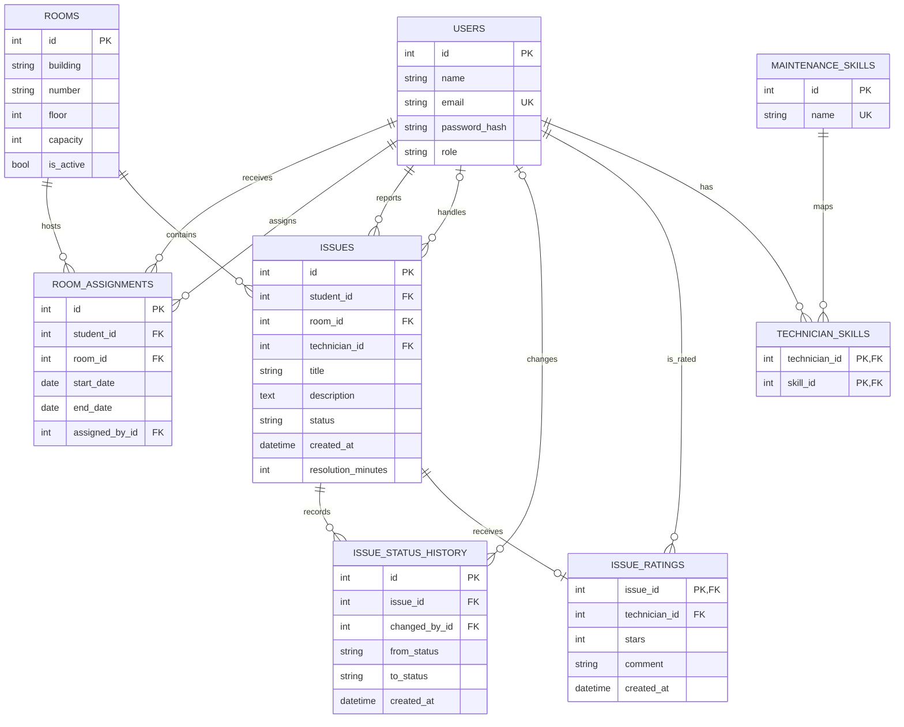

# Veritabanı Tasarımı — Proje 14

## ER Diyagramı

`users` tablosu üç rolü de saklar. `room_assignments` önceki oda atamalarını korur; kısmi benzersiz indeks her öğrenci için en fazla bir etkin atama olmasını sağlar. Atama sırasında odanın kapasitesi kontrol edilir. `technician_skills`, teknisyenler ile bakım uzmanlıkları arasındaki N:N ilişkisini çözer. `issue_status_history`, her durum değişikliğini ayrı kaydeder.

## İlişkiler ve kardinaliteler

- Öğrenci 1:N OdaAtaması; Oda 1:N OdaAtaması. Atama geçmişi öğrenci-oda ilişkisini dönemler boyunca korur.
- Öğrenci 1:N Arıza; Oda 1:N Arıza; Teknisyen 1:N Arıza (atama öncesinde teknisyen boş olabilir).
- Arıza 1:N DurumGeçmişi; Kullanıcı 1:N DurumGeçmişi (silinmiş hesaplarda işlem yapan kullanıcı boş olabilir).
- Teknisyen N:N BakımUzmanlığı; ara tablo `technician_skills`.

## 3NF normalizasyon gerekçesi

- **1NF:** Her alan tek bir değer taşır. Tekrarlanan durum değişiklikleri, teknisyen uzmanlıkları ve oda atama geçmişi ayrı satır ve tablolarda tutulur.
- **2NF:** Anahtar olmayan alanlar anahtarın tamamına bağlıdır. `technician_skills` birleşik anahtarı `(technician_id, skill_id)` kullanır ve anahtar dışı alan içermez. Diğer tablolarda tek sütunlu birincil anahtar vardır.
- **3NF:** Oda bilgileri yalnızca `rooms` tablosunda; kullanıcı ve rol bilgileri `users` tablosunda; uzmanlık adı `maintenance_skills` tablosunda tutulur. Arıza geçmişi `issues` tablosunda yinelenmez. Anahtar olmayan alanlar anahtara, anahtarın tamamına ve yalnızca anahtara bağlıdır.

`issue_ratings`, kapatılmış bir talep için öğrenci puanını ve değerlendirilen teknisyeni tek satırda tutar; `issue_id` birincil anahtarı her talebe en fazla bir değerlendirme bağlar. Böylece teknisyen sonradan değişse bile değerlendirme hangi teknisyene ait olduğunu korur. Puan 1–5 aralığındadır; yorum isteğe bağlıdır ve 1000 karakterle sınırlıdır.

Şemada sekiz ilişkili tablo, PK/FK'ler, benzersizlik ve kontrol kısıtları ile e-posta, yabancı anahtarlar ve arıza durumu/tarihi için indeksler kullanılır. ORM sorguları SQLAlchemy parametreli ifade API'si üzerinden çalışır.
